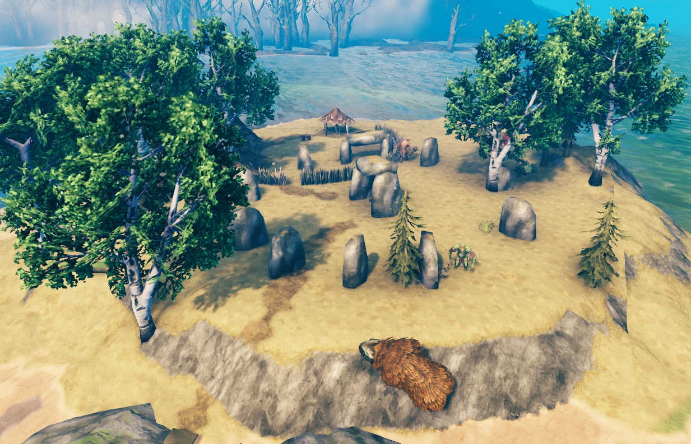
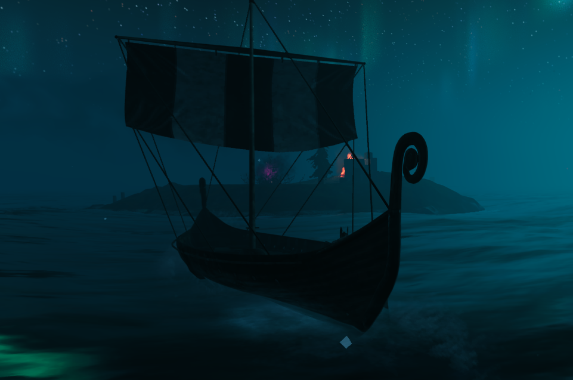
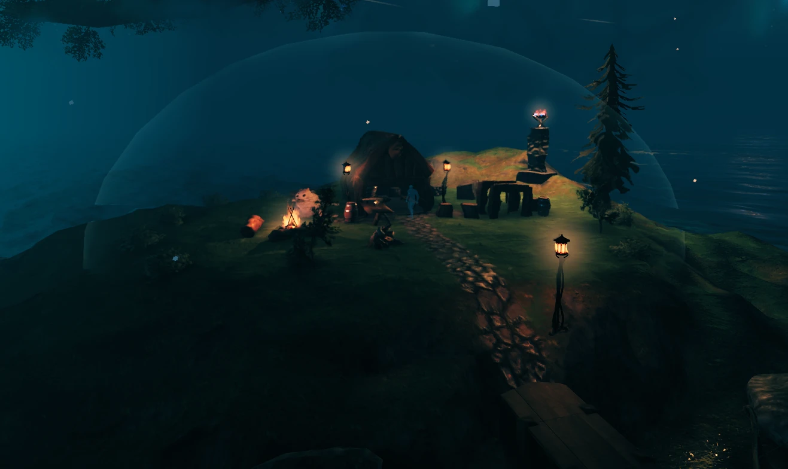
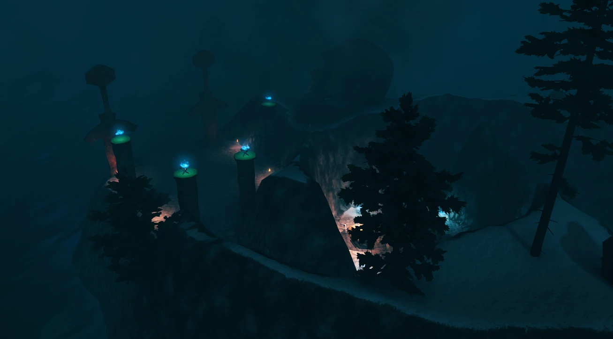

# IslandsOfValheim

Small islands out at sea with old ruins, dvergr outposts, guards and treasure, tougher the further you sail from the centre, a few large islets with a vanilla dungeon or a stronghold and life of their own, and a sea trader with a tale to tell. Works in new and existing worlds.

Needs [Jötunn](https://thunderstore.io/c/valheim/p/ValheimModding/Jotunn/).

|  |  |
|---|---|
|  |  |

## What changes?

Valheim's ocean is mostly empty water between continents. This mod puts small islands in it, worth sailing to:

- **Islets** in the open sea, away from the coasts, with ruins or one of the game's own structures on top, often a tower or graves on the cliff, sometimes an old jetty or a wrecked ship on the shore, plus berries, mushrooms, flint and branches to pick up.
- **Guards** that show up when you come close, once: killed guards don't come back.
- **Treasure.** One chest per islet. Sometimes it holds a **sea vegvisir shard**: use it (right-click in your inventory) and it marks the closest islet nobody has visited yet on your map, one of the kind of the waters you're in or a tougher one, so one islet leads you to the next. If none is left, the shard isn't used up.
- **Signs from the sea.** Gulls circle over every islet by day, and a fire burns on its cliff at night, so you can spot one from your boat.
- **Old beacons** on about one islet in three: light one and it shows you the islets around it (see below).
- **Fishing grounds** around about half the islets (see below).
- **Large islets**, three of each kind, each of its own design, some guarded, some peaceful. Their ground is the game's own: dig, level and farm on it (see below).
- **The sea trader**, the last of the people who built the islet ruins, keeps a harbour on one islet (see below).

The further from the world centre, the tougher the islet:

| Islet | Distance from the centre | Guards | Loot |
|---|---|---|---|
| Meadows | 300-2200 m | Greydwarfs, a Greydwarf Shaman | coins, amber, amber pearls, rubies, fire arrows |
| Swamp | 2200-4000 m | Draugr, a Draugr archer, a Draugr Elite | coins, iron scrap, chain, withered bones, iron arrows |
| Plains | 4000-5800 m | Fulings, a Fuling archer and shaman | coins, black metal scrap, silver necklaces, needle and obsidian arrows |
| Mistlands | 5800-7500 m | Seekers, a Seeker Brute | coins, soft tissue, black marble, black cores, carapace arrows |
| Dvergr outpost | 5800-7500 m, about one Mistlands-ring islet in four | dvergr rogues and a fire, an ice and a support mage, neutral until provoked | coins, black cores, dvergr extractors, lanterns, soft tissue, iron, copper, yggdrasil wood |
| Ashlands | 7500 m and further, southern half of the world | Charred warriors, an archer and a mage | coins, flametal ore, grausten, gemstones, molten cores, charred arrows |
| Deep North | 7500 m and further, northern half of the world | a Deep North skeleton, Ulvs, a Cultist, a Fenring | coins, frostwood, ice, frost cores, crystal, silver, freeze glands, frost arrows |

Each kind has its own ground, painted like its biome, its own plants, and what stands on it belongs to its land: our own ruins, or one of the game's own structures of that land (from 1.10.0). Every kind comes in four shapes, what's on top is turned differently from islet to islet, and towers, wrecks, jetties and plants are there on some islets and not on others, so no two islets look quite the same.

About one islet in four has a **creature nest** instead of a ruin (a Greydwarf nest, a Swamp bone pile, Seeker eggs, Charred twitcher nests): break it before it sends more. About one in eight hides a **hoard**: a second, richer chest tucked between rocks on the slope (it isn't buried, look around). Some have a runestone.

The islands are built from the game's own rocks and building pieces, so they look like they belong. Like vanilla ruins, their walls can be broken for stone and wood.

## Old beacons

About one islet in three has a broken beacon tower up by the cliff, with a cold brazier on top. Use the brazier and pay its fuel (shown when you look at it) to light it:

| Islet | Fuel | Who saw the light |
|---|---|---|
| Meadows | 10 wood and 5 resin | Necks climb out of the sea |
| Swamp | a surtling core and 5 coal | Draugr climb out of the sea |
| Plains | 2 surtling cores and 10 coal | Deathsquitos fly in, Fulings come ashore |
| Mistlands | a black core, or 3 surtling cores | Ticks drop in, Seekers come ashore |
| Dvergr outpost | a dvergr lantern, or 2 black cores | Seekers come ashore, and the dvergr fight them with you |
| Ashlands | a molten core, or 5 surtling cores | Voltures fly in, Charred come ashore |
| Deep North | 10 frostwood and 2 surtling cores | Ulvs and a Cultist come ashore |

Once lit, a beacon burns for good, for everyone. Its light marks every islet within about 700 m on your map (the game's map can't show the islets themselves, only open sea) and clears the fog around it. Anyone who comes to a lit beacon later gets the same. The small wave of creatures comes only once per beacon. A sea vegvisir shard points to one islet further away; a beacon shows the ones around it.

## Fishing grounds

About half the islets have more fish in the shallow water around them than the open sea has. Watch for a ripple now and then. They're the game's own fish, so each one bites on its own vanilla bait, and the further out you go, the rarer the fish and the more stars they have:

| Islet | Fish | Levels |
|---|---|---|
| Meadows | perch, sometimes pike | 1-2 |
| Swamp | giant herring, trollfish, pike | 1-2 |
| Plains | grouper, tuna, trollfish | 1-3 |
| Mistlands and dvergr outposts | anglerfish, pufferfish, coral cod | 1-3 |
| Ashlands | magmafish, pufferfish, coral cod | 2-4 |
| Deep North | northern salmon, pufferfish, coral cod | 2-4 |

There aren't endless fish: a ground holds a few at a time and puts one back every few minutes. Now and then your hook brings up a sodden pouch instead of a fish, with some coins and a small piece of the islet's treasure, and very rarely a sea vegvisir shard.

## Large islets

Rarely, three of each kind in a world (`LargeIsletsPerKind`), there's a much bigger islet, three to four times a normal one, in the same ring as that kind's small ones. Each kind comes in three designs, and with the default setting a world gets each of them once, so no two are alike. Some hold one of the game's dungeons or a stronghold, with a starred guardian, a few of the kind's creatures and a chest of their own; some are peaceful, left to the animals and to what the people who lived there left behind.

All have life of their own that comes back, the animals of their land: when there are fewer than a few, one comes back every few minutes, but not near a player's base. Some can be tamed. Trees, berries and mushrooms grow back the game's way.

Like the small islets, the further out in its ring a large islet is, the tougher it gets: in the inner third its creatures have no stars, in the middle third some have one, in the outer third some have two, and the chest grows with it.

You may build on a large islet and settle there. Its ground is the game's own terrain, raised out of the sea: the hoe, the pickaxe and the cultivator work on it, and crops grow there. (A large islet already built in a world before 1.10.0 stays as it was, on its old ground, where they don't work; the ones nobody had reached yet come up the new way.)

## The sea trader

Somewhere in the Swamp or Plains waters there's one peaceful islet with a harbour, the last one the seafaring people kept: a thatched plank house on the stone floor of their old harbour hall, his counter in front of it and a paved path down to the shore, a campfire with benches, a fisher's corner, an old hull he's mending, a jetty with a moored karve, a statue of one of their captains and, on the ridge, one of their beacon towers, whole, its fire never out. No guards, and creatures keep away from it. Sævar lives there, the last of the seafaring people whose ruins are on the other islets. He's one of the shadows of the Deep North, the ghosts of the fallen, standing at his counter. His seal Bára lies on her straw mat by the campfire (you can pet her), and like a vendor's camp, his islet is under a see-through dome nobody can build under.

Like Haldor, the game picks several possible spots for his harbour, and the first one somebody comes near is the one that's built; the others vanish. From then on a white anchor marks it on everyone's map. He sells for coins and buys nothing. More of his goods show up as the world's bosses fall:

| When | Goods |
|---|---|
| From the start | Sea vegvisir shard, Ancient Lure (bait for the islet fishing grounds: their fish take it readily and are often a star better; fish anywhere else ignore it), Seafarer's Cape |
| After Bonemass | Caulking Kit (use it on board to repair your ship at sea, no workbench needed), Captain's Hat, Salted Fish |
| After Moder | Seafarer's Vest, Deckhand's Trousers, Storm Mead, Seafarer's Hardtack |
| After Yagluth | Rán's Blessing |

**The Seafarer set** is a travel set, not a combat one: middling armour, and each piece helps at sea.

| Piece | Armour | Effect |
|---|---|---|
| Captain's Hat | 6 | Fishing +10 |
| Seafarer's Vest | 10 | Swimming uses 25% less stamina |
| Deckhand's Trousers | 10 | Being wet wears off twice as fast |
| Seafarer's Cape | 1 | Keeps the night chill and the cold of rain off you (not freezing cold) |
| All four: Child of the Sea | | You never get wet, and you swim 25% faster |

**Meads and food**, mid-strength so they don't replace a good cooked meal:

- Storm Mead (10 minutes): rain and spray don't soak you, and the cold doesn't reach you (not freezing cold).
- Rán's Blessing (10 minutes): you swim 40% faster and use 40% less stamina swimming.
- Salted Fish: 25 health, 50 stamina, lasts 40 minutes.
- Seafarer's Hardtack: 35 health, 35 stamina, lasts an hour.

In an existing world his harbour is added like the islets (see below).

## Sævar's tale

Sævar has a story to tell, about the Brim Folk, his people, and what the sea gave them. He tells it a step at a time. Talk to him and he gives you a torn map; use it (right-click) and it marks roughly where it leads. Go there, do what has to be done, and come back to him for the next page of the tale (in your compendium) and the next map. The tale belongs to the world, not to one player: whoever takes a step, everyone hears the rest.

The tale has seven steps, each further out to sea than the last: the old Brim harbour in the Meadows waters, Ketill's islet in the Swamp waters, Sigrún's islet in the Plains waters, Ormr's islet in the Mistlands waters, a dvergr outpost that keeps something it shouldn't, a shore in the Ashlands waters where it all began, and at last a dark crag in the Deep North waters: a hidden cove, then three hollows one above the other, each with a keeper between you and the last fragment, and ice across the way up until the keeper below it falls. Some fragments are guarded, some are hidden, one has to be fished out of the sea, and one belongs to the dvergr, who won't like you taking it. Bring Sævar the last one and the tale ends, with a trinket for you to keep. His goods stay on sale after that.

The tale's foes and the trader's goods use the game's own models, reworked with new names, stats, colours and fights. No new models are added.

While you carry a fragment of what the Brim Folk found, the sea turns against you: a storm over you wherever you go, and serpents that come looking. Fragments can't go through portals. Each fragment you bring Sævar adds to his goods:

| After | Goods |
|---|---|
| The old harbour | Brim Oil: lights any old beacon |
| Ketill | Storm Glass (10 minutes): the sea leaves you be, even while you carry a fragment |
| Sigrún | Gull Feather (5 minutes): the wind is always at your back while you sail |
| Ormr | Brim Harpoon: an Abyssal Harpoon that hits 30% harder |
| The dvergr | Serpent Charm (10 minutes): serpents deal half damage to you, and the restless sea sends none |
| The Ashlands shore | Ash-sea Tar (10 minutes): the burning sea doesn't harm the ship you're on |
| The end of the tale | (not sold) Heart of the Sea, a trinket: you swim 30% faster and use 30% less stamina swimming, and serpents deal half damage to you |

### The tale's bosses

Four of the tale's foes are bosses of their own, each with its own look, words and fight in stages as its health runs down, and its own end. They're made of the game's own creatures and effects.

| Boss | Where | Fight |
|---|---|---|
| Ketill | Swamp waters | A drowned captain. Heavy blows that throw you back, cuts that poison; his dead crew rises around him, and at the end the sky darkens and lightning falls where you stand (a mist marks the spot first). |
| Grímr | Deep North waters | The first keeper. Ice bursts from the ground at his feet and stiffens you; he raises a frost shield twice, and in his rage every blow chills. |
| Ormr | Deep North waters | The second keeper. He goes into a mist and comes out behind you, his crew's shades fight for him, and at the end the curse feeds him: what he deals you heals him. |
| Hafdís | Deep North waters | The last keeper. Her feathers rain down where you're heading (a gold light marks the spot), the sea drags you to her, her claws reach whoever stands under her, and at the end she calls the storm. |

## Dvergr outposts

Some islets in the Mistlands ring aren't ruins: dvergr live there. Like the dvergr camps on land, they leave you alone as long as you leave them alone, so you can land, look around and sail on in peace. Or raid them: hitting a dvergr, breaking anything of theirs (walls, crates, barrels, furniture), taking the stein or lantern off their table or the black core from its stand, or opening their chest turns the whole outpost against you. Their chest is worth it, and so is the black core. You can't build on their islet, the same as in their camps on land.

Now and then you arrive in the middle of a fight: Seekers have come ashore and the dvergr are fighting them.

## New worlds and existing worlds

Valheim decides where locations go when a world is created, and only builds them when someone first comes near.

- **New world:** islets are there from the start.
- **Existing world:** once per world, the server (or the host, or you in single player) adds the islets the world is missing, Sævar's harbour and the islets of his tale too. Most go where nobody has sailed yet and appear when someone gets there. Only if a kind's ring has no such sea left, a few are built in ocean you've already sailed, well away from anything players built, from ships and from players. It runs about ten seconds after the world loads and writes what it added to the log. `PlaceInExistingWorlds` turns it off, and `iov_placeislets` runs it again.
## Bigger worlds

The distances above are for a vanilla-sized world. With [Expand World Size](https://thunderstore.io/c/valheim/p/JereKuusela/Expand_World_Size/) the rings grow with the world radius (that mod moves every location's distances itself), so a Meadows islet is still near the centre and Ashlands islets are still far out. The outer ring is split by a line running east-west through the world centre, the same way the game divides the Deep North from the Ashlands, so that stays true in any world size.

## Configuration

- `MeadowsIslets`, `SwampIslets`, `PlainsIslets`, `MistlandsIslets`, `DvergrIslets`, `AshlandsIslets`, `DeepNorthIslets`: how many islets of each kind the game tries to place (0 turns a kind off). Only used when locations are generated (new world or `genloc`).
- `LargeIsletsPerKind`: how many large islets of each kind the game tries to place (0 turns them off).
- `PlaceInExistingWorlds`: adds the missing islets to a world once (on by default).
- `SeaTraderIslets`: how many possible spots the game picks for the sea trader's harbour (only the first one somebody comes near is built). 0 turns him off.
- `GroundStyle`: how the islet ground looks: `Terrain` (like the game's own land) or `Rock` (bare stone). Needs a restart.
- `DebugLog`: writes how the islands were built and where they are to the BepInEx log.

## Console commands

- `iov_info`: how many islets of each kind this world has and how far the closest ones are (host or single player).
- `iov_goto [kind]` (needs `devcommands`): teleports you to the closest islet nobody has been to yet, for example `iov_goto swamp`, `iov_goto dvergr` or `iov_goto deepnorth`. `iov_goto trader` takes you to the sea trader's harbour, `iov_goto story1` to `iov_goto story7` to the islets of his tale, `iov_goto large_meadows` (`large_swamp`, `large_plains`, `large_mistlands`, `large_dvergr`, `large_ashlands`, `large_deepnorth`) to a large islet.
- `iov_placeislets` (needs `devcommands`, host or single player): adds the islets this world is missing now.
- `iov_light` (needs `devcommands`): shows the light from the end of Sævar's tale in front of you, without spoiling the tale.

## Translations

The mod comes in English and Turkish, and follows the game's language. Its texts are in `Translations/<Language>/IslandsOfValheim.json` in the mod's folder.

To change a text, or to add a language, put a file of your own in `BepInEx/config/IslandsOfValheim/Translations/<Language>/` (for example `BepInEx/config/IslandsOfValheim/Translations/Turkish/MyTexts.json`) with only the keys you want, in the same format. Files there win over the mod's own, and an update doesn't touch them. The language folder is named like the game's languages (English, Turkish, German, French...).

## Multiplayer

**Note:** Multiplayer and dedicated servers haven't been tested yet. It's built to work there, but if something seems off, please report it on GitHub Issues.

Install it on the server and on every player's game: the islands are part of the world, and everyone needs the mod to see them. Jötunn checks that everyone has the same version.

## Feedback and bug reports

Found a bug or have an idea? Open an issue on [GitHub](https://github.com/aetuss/IslandsOfValheim/issues). Turn on `DebugLog` and include the matching lines from `BepInEx/LogOutput.log`.

Stuck in Sævar's tale, or did one of its steps not work the way it should? You can also reach me on Discord: **aethuswulf**.

## Thanks

The idea of raising the large islets out of the game's own terrain came from Shuiei's [Valheim World Editor](https://github.com/Shuiei/valheim-world-editor) (MIT licence). None of its code is used.

## Made with AI

aetuss decided what this mod does and how it should work, and tested it in game. The code, the icon, this description and the Turkish translation were written by Claude, an AI model by Anthropic (through Claude Code); aetuss checked the Turkish texts in game. The screenshots are aetuss's own, taken in game.
